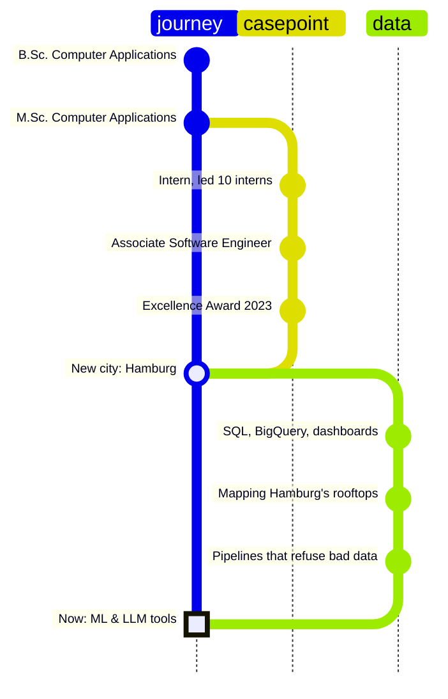

<h1 align="center">Dhrupti Pambhar</h1>

<p align="center">
  <i>From production backends to pipelines and models: a learning log, kept in public.</i><br>
  C#/.NET engineer · Surat → Hamburg · exploring data & AI
</p>

---

```csharp
var dhrupti = new Engineer
{
    From         = "Surat, India",
    Now          = "Hamburg, Germany",
    Craft        = "C#/.NET backends, SQL Server, PostgreSQL",
    Exploring    = ["data engineering", "machine learning", "LLM-powered tools"],
    Speaks       = ["English", "Deutsch", "ગુજરાતી", "हिन्दी"],
    FavouriteBug = "a '#' comment line in a CSV that pandas crowned as the header",
};
```

## 🗺️ The route so far



**Chapter 1 · Surat.** Bachelor's and Master's in Computer Applications at Veer Narmad South Gujarat University. That's where I learned to code, and where I found out I like the part *behind* the screen best.

**Chapter 2 · Casepoint.** Two-plus years building backend features for a LegalTech platform that ingests, tags and archives over 10 GB of documents a day, in a 15-person Scrum team. Here's what production taught me, written as a changelog:

```diff
- critical document query                     ~60 s
+ critical document query                     ~30 s    read the query plan, then index

- frequent database calls                    baseline
+ frequent database calls                  15% fewer    Redis cache + RabbitMQ events

- Elasticsearch search                       baseline
+ Elasticsearch search                   ~20% faster

  SQL Server → PostgreSQL, one customer's data model
+ 0 rows lost · every change traceable
```

**Chapter 3 · Hamburg.** A new city, a new language, and a new question: what happens to data *after* it leaves the database? At ReDI School I picked up Python, GeoPandas and BigQuery, and started building things in the open. They're all in the build log below.

**Chapter 4 · Now.** Machine learning fundamentals in the ReDI School AI/ML programme, plus small tools that put LLMs to practical use.

## 📓 Build log

Newest first. Each project comes with the one lesson I took from it.

**Oct 2026 · [Mental Health Signal](https://github.com/Dhru1999/Teen-Mental-Health-Estimator)**  
My first ML model behind an API: a scikit-learn pipeline served with FastAPI and a small web form. A learning project, not a screening tool.  
💡 *Train R² 0.98, test R² 0.88. The gap between those two numbers is the whole story.*

**Jul 2026 · [Smart Retail Data Platform](https://github.com/Dhru1999/smart-retail-data-platform)**  
A small ETL pipeline built step by step, with daily notes, around one rule: *no row disappears quietly*.  
💡 *A pipeline that loads 0 rows and reports "success" is worse than one that crashes.*

**Jun 2026 · [Job Application Follow-Up Assistant](https://github.com/Dhru1999/Auto-Follow-Up-Tool-Using-Claude-Code)**  
A C# desktop tool that reads an Excel tracker, drafts follow-ups with the Claude API, and sends them only after I've reviewed them.  
💡 *An `.xlsm` file is just a zip of XML. Reading it directly beats fighting a library.*

**Jun 2026 · [Rooftop Solar Potential, Hamburg](https://github.com/Dhru1999/Renewable-Solar-Potential-Across-Hamburg-District-Analysis)**  
A team project: 384,908 buildings spatially joined to 104 districts to see where the city's rooftop solar capacity sits.  
💡 *383 buildings sat exactly on district borders. Check what a join drops, not only what it keeps.*

**May 2026 · [Social Media & Teen Mental Health](https://github.com/Dhru1999/Social-Media-Impact-on-Teen-Mental-Health)**  
Exploratory analysis of habits, sleep and stress in a 1,200-row public dataset.  
💡 *EDA is mostly asking the next question.*

**Apr 2026 · [Sales & Customer Insights](https://github.com/Dhru1999/Sales-and-Customer-Report-Using-Looker-Studio)**  
A Looker Studio dashboard over 10,000 transactions.  
💡 *"No relationship between churn and spending" is a finding too.*

**Apr 2026 · [BigQuery SQL Analytics](https://github.com/Dhru1999/BigQuery-SQL-Analytics-thelook_ecommerce-)**  
GoogleSQL practice on an e-commerce dataset: CTEs, window functions, aggregations.  
💡 *Thinking in sets instead of loops.*

**2025 · [MultizipExtraction](https://github.com/Dhru1999/MultizipExtraction) · [CRUD with ASP.NET Core](https://github.com/Dhru1999/CrudOperationUsingNETCore)**  
Small C# tools and experiments.  
💡 *Where this public log started.*

## 🧰 Toolbox

| | |
|---|---|
| **Used daily at work** | C#, ASP.NET MVC 5, .NET Core, REST / Web API, WPF, Blazor, SQL Server, PostgreSQL, RabbitMQ, Redis, Elasticsearch, Git |
| **Built projects with** | Python, pandas, GeoPandas, SQLAlchemy, BigQuery, Looker Studio, FastAPI, scikit-learn, Claude API, pytest, GitHub Actions |
| **Learning right now** | Machine learning, end to end: data → model → API |

## 🌱 Currently

- 📚 working through the ReDI School AI/ML programme
- 🔧 turning notebooks into tested, re-runnable code
- 🇩🇪 getting better at German, one conversation at a time

---

<p align="center">
  Happy to talk backend, data pipelines, or maps of Hamburg:
  <a href="https://www.linkedin.com/in/dhrupti-pambhar/">LinkedIn</a> · <a href="mailto:dhrupti.pambhar1999@gmail.com">Email</a>
</p>
