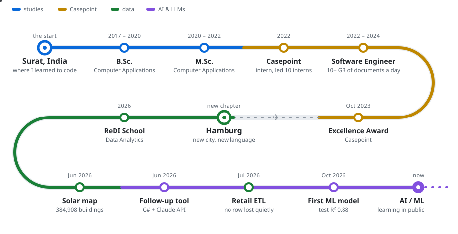
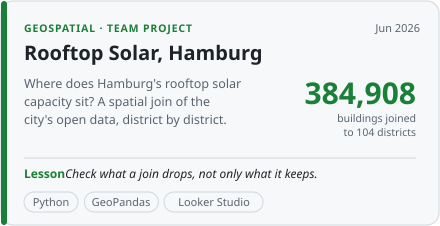
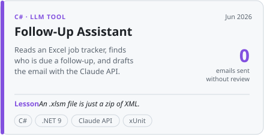
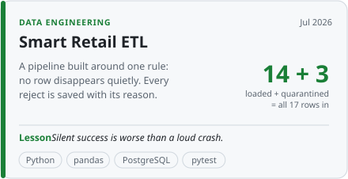
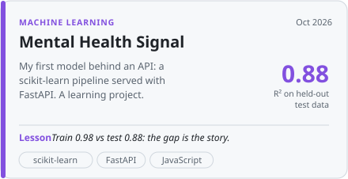

<h1 align="center">Dhrupti Pambhar</h1>

<p align="center">
  <i>From production backends to pipelines and models: a learning log, kept in public.</i><br>
  C#/.NET engineer · Surat → Hamburg · exploring data & AI
</p>

---

```csharp
var dhrupti = new Engineer
{
    From         = "Surat, India",
    Now          = "Hamburg, Germany",
    Craft        = "C#/.NET backends, SQL Server, PostgreSQL",
    Exploring    = ["data engineering", "machine learning", "LLM-powered tools"],
    Speaks       = ["English", "Deutsch", "ગુજરાતી", "हिन्दी"],
    FavouriteBug = "a '#' comment line in a CSV that pandas crowned as the header",
};
```

## 🗺️ The route so far

<p align="center">
  <picture><source media="(prefers-color-scheme: dark)" srcset="assets/journey-dark.svg"></picture>
</p>

**Chapter 1 · Surat.** Bachelor's and Master's in Computer Applications at Veer Narmad South Gujarat University. That's where I learned to code, and where I found out I like the part *behind* the screen best.

**Chapter 2 · Casepoint.** Two-plus years building backend features for a LegalTech platform that ingests, tags and archives over 10 GB of documents a day, in a 15-person Scrum team. Here's what production taught me, written as a changelog:

```diff
- critical document query                     ~60 s
+ critical document query                     ~30 s    read the query plan, then index

- frequent database calls                    baseline
+ frequent database calls                  15% fewer    Redis cache + RabbitMQ events

- Elasticsearch search                       baseline
+ Elasticsearch search                   ~20% faster

  SQL Server → PostgreSQL, one customer's data model
+ 0 rows lost · every change traceable
```

**Chapter 3 · Hamburg.** A new city, a new language, and a new question: what happens to data *after* it leaves the database? At ReDI School I picked up Python, GeoPandas and BigQuery, and started building things in the open. You'll find them all in the featured builds below.

**Chapter 4 · Now.** Machine learning fundamentals in the ReDI School AI/ML programme, plus small tools that put LLMs to practical use.

## 🧪 Featured builds

Click a card to open the project. Each one comes with the lesson it taught me.

<p>
  <a href="https://github.com/Dhru1999/Renewable-Solar-Potential-Across-Hamburg-District-Analysis"><picture><source media="(prefers-color-scheme: dark)" srcset="assets/cards/solar-dark.svg"></picture></a>
  <a href="https://github.com/Dhru1999/Auto-Follow-Up-Tool-Using-Claude-Code"><picture><source media="(prefers-color-scheme: dark)" srcset="assets/cards/followup-dark.svg"></picture></a>
</p>
<p>
  <a href="https://github.com/Dhru1999/smart-retail-data-platform"><picture><source media="(prefers-color-scheme: dark)" srcset="assets/cards/etl-dark.svg"></picture></a>
  <a href="https://github.com/Dhru1999/Teen-Mental-Health-Estimator"><picture><source media="(prefers-color-scheme: dark)" srcset="assets/cards/ml-dark.svg"></picture></a>
</p>

<details>
<summary><b>More from the log</b>: SQL, dashboards and early C# tools</summary>

- **May 2026 · [Social Media & Teen Mental Health](https://github.com/Dhru1999/Social-Media-Impact-on-Teen-Mental-Health)**: exploratory analysis of habits, sleep and stress in a 1,200-row public dataset. *EDA is mostly asking the next question.*
- **Apr 2026 · [Sales & Customer Insights](https://github.com/Dhru1999/Sales-and-Customer-Report-Using-Looker-Studio)**: a Looker Studio dashboard over 10,000 transactions. *"No relationship between churn and spending" is a finding too.*
- **Apr 2026 · [BigQuery SQL Analytics](https://github.com/Dhru1999/BigQuery-SQL-Analytics-thelook_ecommerce-)**: GoogleSQL practice with CTEs, window functions and aggregations. *Thinking in sets instead of loops.*
- **2025 · [MultizipExtraction](https://github.com/Dhru1999/MultizipExtraction) · [CRUD with ASP.NET Core](https://github.com/Dhru1999/CrudOperationUsingNETCore)**: small C# tools and experiments. *Where this public log started.*

</details>

## 🧰 Toolbox

| | |
|---|---|
| **Used daily at work** | C#, ASP.NET MVC 5, .NET Core, REST / Web API, WPF, Blazor, SQL Server, PostgreSQL, RabbitMQ, Redis, Elasticsearch, Git |
| **Built projects with** | Python, pandas, GeoPandas, SQLAlchemy, BigQuery, Looker Studio, FastAPI, scikit-learn, Claude API, pytest, GitHub Actions |
| **Learning right now** | Machine learning, end to end: data → model → API |

## 🌱 Currently

- 📚 working through the ReDI School AI/ML programme
- 🔧 turning notebooks into tested, re-runnable code
- 🇩🇪 getting better at German, one conversation at a time

---

<p align="center">
  Happy to talk backend, data pipelines, or maps of Hamburg:
  <a href="https://www.linkedin.com/in/dhrupti-pambhar/">LinkedIn</a> · <a href="mailto:dhrupti.pambhar1999@gmail.com">Email</a>
</p>
