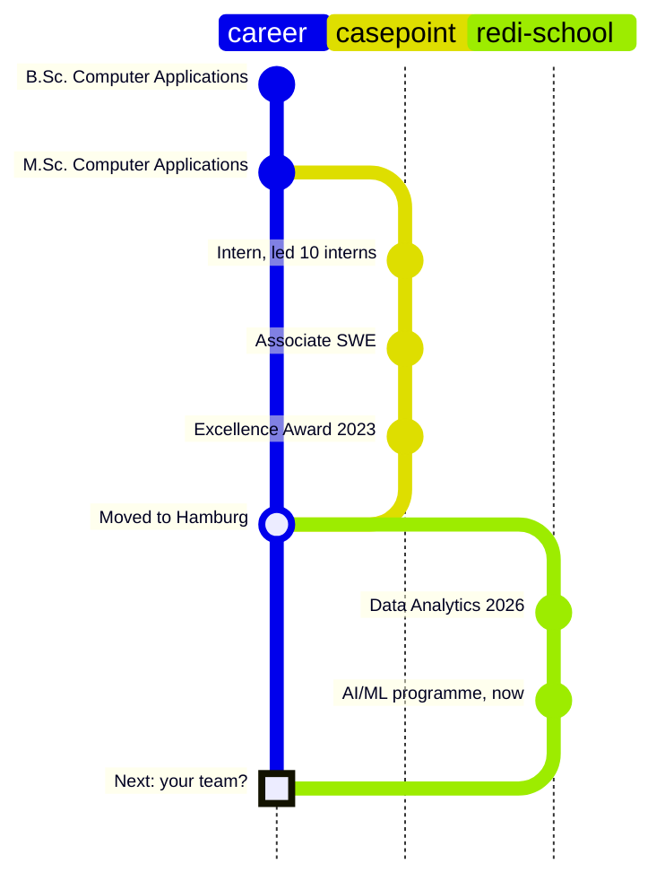

<h1 align="center">Hi, I'm Dhrupti</h1>

<p align="center">
  <b>Backend engineer who makes slow queries fast and messy data honest.</b><br>
  C#/.NET by trade · Python, data and AI by choice · based in Hamburg
</p>

<p align="center">
  <a href="https://www.linkedin.com/in/dhrupti-pambhar/">LinkedIn</a> ·
  <a href="mailto:dhrupti.pambhar1999@gmail.com">Email</a> ·
  <a href="#-things-i-built">Projects</a>
</p>

---

```csharp
var dhrupti = new Engineer
{
    Role       = "Software Engineer · C#/.NET backend",
    Experience = "2+ years at Casepoint (US LegalTech)",
    Stack      = [".NET", "SQL Server", "PostgreSQL",
                  "RabbitMQ", "Redis", "Elasticsearch"],
    NowLearning = ["Machine learning", "LLM apps"],
    Speaks     = ["English C1", "German B2",
                  "Gujarati", "Hindi"],
    LookingFor = "Backend, .NET or data/AI engineering"
                   + "roles in Germany or Remote",
};
```

### 🔧 Release notes: two years of backend work

At Casepoint I worked in a 15-person Scrum team on a document platform that ingests, tags and archives **10+ GB of documents a day**. The parts I'm proudest of, written the way my team would read them:

```diff
- critical document query                      ~60 s
+ critical document query                      ~30 s    query plans + indexing

- Elasticsearch search                        baseline
+ Elasticsearch search                    ~20% faster

- frequent database calls                     baseline
+ frequent database calls                  15% fewer    Redis caching + RabbitMQ events

- production defects                          baseline
+ production defects                    ~25% fewer    team result; I did defect analysis

  SQL Server → PostgreSQL migration of a customer's data model
+ 0 rows lost · full traceability · 50%+ of the query surface moved
```

Also on the changelog: led two Rebex server upgrades from compatibility testing to production, led a 10-person intern team building a reporting & invoicing module (ASP.NET MVC 5, Blazor, PostgreSQL), and received the **Casepoint Excellence Award** (Oct 2023).

### 🧭 Career, as a git graph



### 🛠 Things I built

| Project | The interesting part | Stack |
|---|---|---|
| **[Job Application Follow-Up Assistant](https://github.com/Dhru1999/Auto-Follow-Up-Tool-Using-Claude-Code)** | Reads my Excel job tracker (even macro-enabled `.xlsm`), finds who is due a follow-up, drafts the email with the **Claude API** and sends it after I review it, then ticks one cell in the workbook without touching its formulas. Credentials stay encrypted per Windows user. | C# · .NET 9 · Claude API · Open XML · xUnit · GitHub Actions |
| **[Smart Retail Data Platform](https://github.com/Dhru1999/smart-retail-data-platform)** | An ETL pipeline with one rule: **no row disappears quietly**. Every input row is either loaded or quarantined with a reason, and CI runs it twice against a real PostgreSQL container to prove it. | Python · pandas · SQLAlchemy · PostgreSQL · pytest |
| **[Rooftop Solar Potential, Hamburg](https://github.com/Dhru1999/Renewable-Solar-Potential-Across-Hamburg-District-Analysis)** | Team project: joined **384,908 buildings** to 104 districts (99.9% matched) to find where Hamburg's rooftop solar capacity sits. I planned the project and built the Looker Studio dashboard. | Python · GeoPandas · Looker Studio |
| **[Mental Health Signal](https://github.com/Dhru1999/Teen-Mental-Health-Estimator)** | My first ML model behind a real API: a scikit-learn pipeline served with FastAPI and a small web form. R² 0.88 on held-out data. A learning project, not a screening tool. | scikit-learn · FastAPI · JavaScript |

Smaller analytics work: [BigQuery SQL on an e-commerce dataset](https://github.com/Dhru1999/BigQuery-SQL-Analytics-thelook_ecommerce-) · [Sales & customer dashboard](https://github.com/Dhru1999/Sales-and-Customer-Report-Using-Looker-Studio) · [Social media & teen mental health EDA](https://github.com/Dhru1999/Social-Media-Impact-on-Teen-Mental-Health)

### 🧰 Toolbox, sorted by honesty

| | |
|---|---|
| **Shipped in production** | C#, ASP.NET MVC 5, .NET Core, REST / Web API, WPF, Blazor, SQL Server, PostgreSQL, RabbitMQ, Redis, Elasticsearch, Git, Azure Repos, Agile/Scrum |
| **Built in projects** | Python, pandas, GeoPandas, SQLAlchemy, BigQuery, Looker Studio, Power BI, Claude API, FastAPI, pytest, GitHub Actions |
| **Learning right now** | Machine learning (ReDI School AI/ML programme, 2026) |

### 🎓 Education

- **M.Sc. Computer Applications** — Veer Narmad South Gujarat University, Surat (2020–2022)
- **B.Sc. Computer Applications** — Veer Narmad South Gujarat University, Surat (2017–2020)
- **Data Analytics programme** — ReDI School of Digital Integration, Hamburg (2026)

---

<p align="center">
  <i>Open to backend, .NET and data/AI engineering roles across Germany. Let's talk:</i><br>
  <a href="https://www.linkedin.com/in/dhrupti-pambhar/">LinkedIn</a> · <a href="mailto:dhrupti.pambhar1999@gmail.com">dhrupti.pambhar1999@gmail.com</a>
</p>
